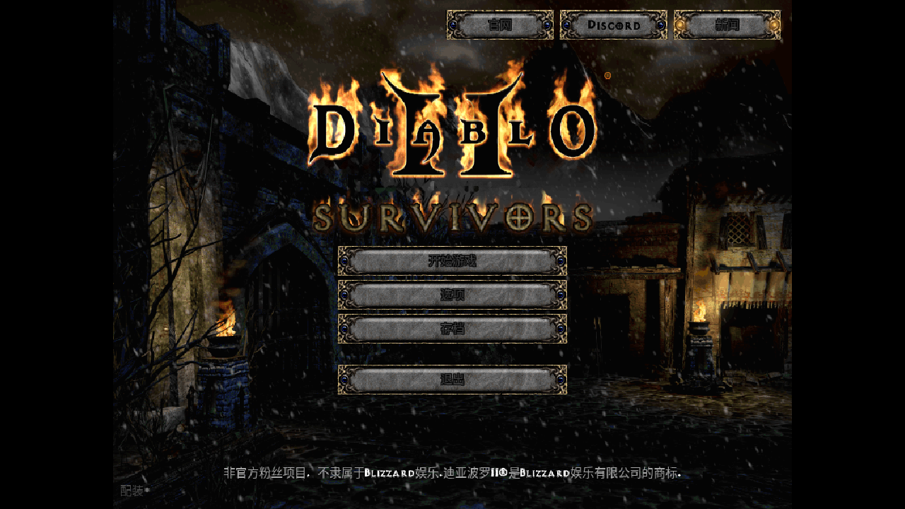
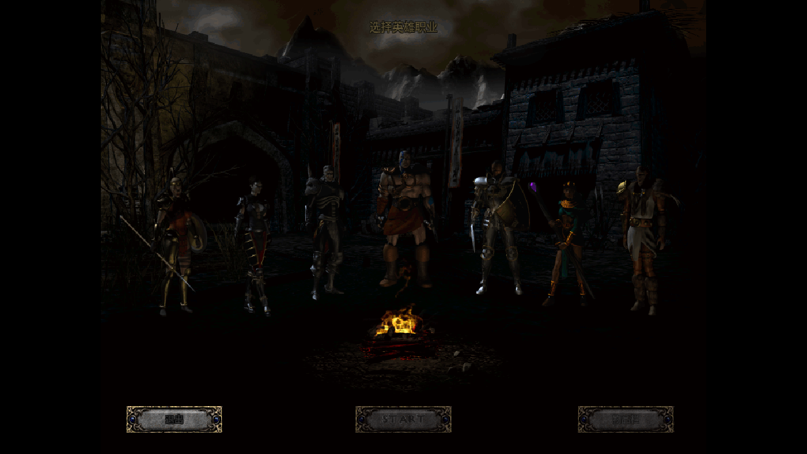

# D2 Survivors 中文离线版

由 https://d2survivors.lol/ 的完整前端资源打包而成，内置全部美术贴图（webp 图集）、音效与音乐，
界面与游戏内文本已汉化，无需联网即可游玩。

## 在线游玩（GitHub Pages）

无需下载，浏览器直接打开：

**https://abu3389.github.io/d2survivors-cn/**

点击首页「在浏览器中游玩」即可开始（资源约 150MB，首次加载需要一些时间，之后有缓存）。

## 离线运行方式

因为浏览器不允许 `file://` 直接加载 ES 模块和 fetch 本地资源，请用一个本地服务器运行：

- Windows：双击 `启动游戏.bat`
- macOS / Linux：终端执行 `./启动游戏.sh`（或 `python3 -m http.server 8000`）

然后浏览器打开 http://localhost:8000/ ，点击「在浏览器中游玩」即可。
（入口会自动附加 `?hosted=1`，表示使用本包内自带的游戏资源。）

## 预览




## 已知问题

- 主菜单等 Canvas 绘制的按钮文字会略微偏右（游戏用固定的按钮文字区排版，中文字宽比英文短）。功能不受影响。
- 技能描述、更新日志等长句由离线机翻生成，个别语句不够通顺；核心术语（职业、属性、暗金/稀有、魔法寻获、压碎打击等）已按 D2 惯例校正。
- 物品名采用「词根直译」组合（如 Rune Aegis → 符文神盾），与官方译名不完全一致。
- 技能树背景图上的英文标题是贴图自带的，未做改图。

## 目录结构

```
index.html            官网首页（已汉化）
play/index.html       游戏本体入口
assets/               前端脚本与样式（含中文词典 zh-CN-D2S.js）
d2/                   D2 原始资源：图集、音效、音乐（约 137 MB）
```

## 汉化说明

- 游戏自带的 i18n 框架原本只有 en / ko，本版新增了 zh（简体中文）。
- 中文词典 `assets/zh-CN-D2S.js` 共 5813 条，覆盖界面、技能、物品、怪物、区域与更新日志。
- 需要手动改词时，直接编辑该词典（`"英文":"中文"`）后刷新页面即可，无需重新打包。
- 语言切换：游戏内 Options 里可切回 ENGLISH / 한국어。

## 版权说明

本项目是原作者 framara 的非官方免费同人作品的本地化版本，不是本人原创。
Diablo® 与 Diablo II® 为 Blizzard Entertainment, Inc. 的商标，全部美术与音频资源版权归原权利人所有。
请仅用于个人学习、体验与备份，勿用于任何商业用途。
